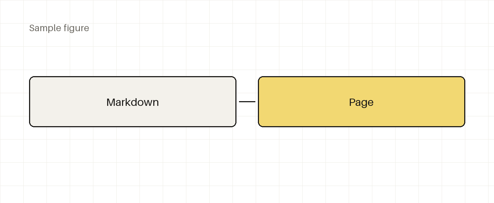
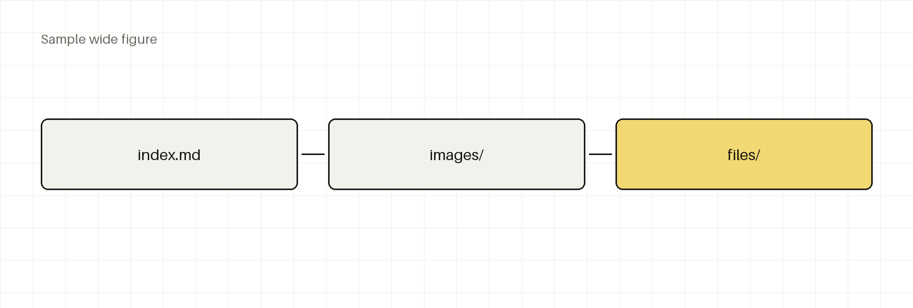

This draft exists so you can see how each piece of Markdown looks on the site. Open it at
`/articles/formatting-reference/` while `npm run dev` is running, and copy whatever you need from
`src/content/articles/formatting-reference/index.md`.

The first paragraphs of an article need no special treatment. Write plain paragraphs separated by a
blank line. Use **bold** for the few words that matter, *italics* for titles and emphasis, and
[links](https://subash.org) wherever a source helps the reader.

## Headings become the Contents list

Every `##` heading is a section. Sections are listed in the collapsed **Contents** box under the
title, so name them the way you would in a table of contents.

### Smaller headings

Use `###` inside a section when it needs sub-points. They do not appear in Contents.

## Lists

A list with bold lead-ins reads well for parallel points:

- **Architectural drift:** the first words in bold say what the point is about.
- **Dependency hallucination:** the sentence after the colon explains it.
- **Token waste:** keep each item to a sentence or two.

Numbered lists work the same way:

1. Copy the `_template` folder.
2. Write the article.
3. Commit and push.

## Images and captions

Put the image file in this article's `images/` folder and reference it with a relative path. The
text in quotes becomes the caption.



Add `{wide}` at the end of the caption to let a detailed diagram break out of the column:



## Quotes

> Stop treating specs as conversations. Start treating them as blueprints.

## Tables

| § | Section | Draws from |
|---|---|---|
| 1 | Problem and appetite | Shape Up pitch |
| 2 | Context and existing system | IEEE 830 Overall Description |
| 3 | Solution shape | Shape Up breadboard |

## Code

Inline code such as `agentic-spec-template.md` sits in the sentence. Longer code goes in a fenced
block with the language after the opening fence:

```md
# Shaped Spec: [FEATURE NAME]

<!--
  HOW TO USE
  - Hydrate this document on the shaping track.
  - Keep sketches at fat-marker fidelity. Keep constraints precise.
-->

## 0. Metadata and shaping status
```

```ts
export function readingTime(words: number): string {
	// about 230 words a minute
	return `${Math.max(1, Math.round(words / 230))} min read`;
}
```

## A rule between sections

Three dashes on their own line draw a rule:

---

That is everything. Tags, dates, the hero image and the "Originally published in" line all come
from the block at the top of the file, never from the text.
