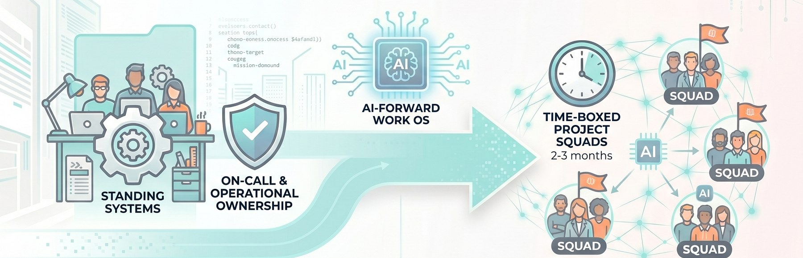
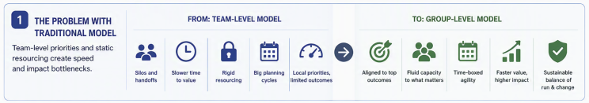
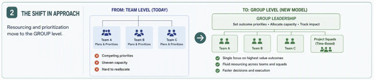
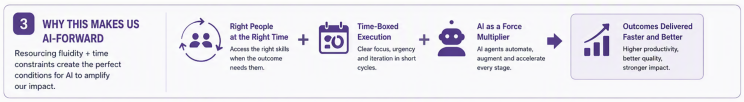
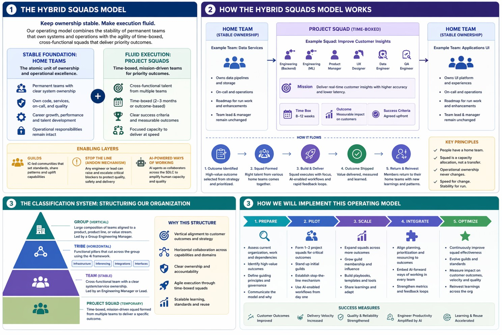
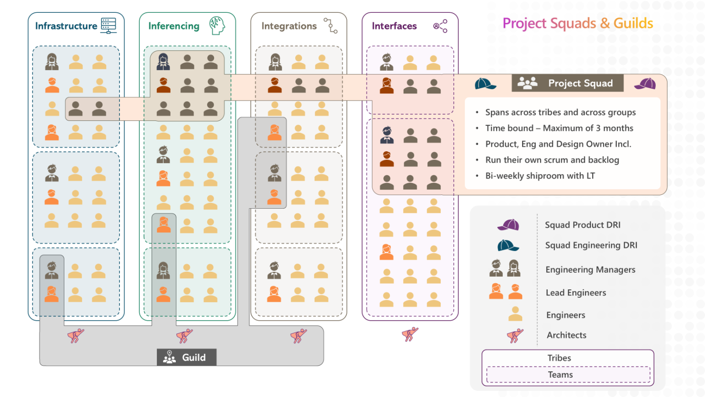

Most large technology organizations eventually face the same paradox. *The systems that made them successful become the systems that slow them down.*

Stable teams, mature ownership models, production operations, compliance responsibilities, customer commitments, and deeply specialized engineering domains are all signs of a grown-up product organization. They are also the reason transformation is hard. You cannot simply declare*”we are a frontier team now”* and reorganize everyone into random squads without risking the reliability of products that customers already depend on.

At the same time, the world around these organizations is changing faster than their operating models were designed to handle. Customer expectations move quickly. AI-native SDLC tools allow for compressed product development cycles. New capabilities that once took quarters to prototype can now be shipped in weeks. Leaders are asked to do more with flat or, in some cases, reduced headcount. Engineering teams are expected to deliver faster, learn and adapt faster, and use AI not as a side tool but as part of the daily fabric of how work gets done.

This creates a fundamental leadership challenge:

> ***How do you move a large, established product organization toward a faster, more agile, AI-forward operating model without dismantling the teams, ownership, and operational discipline that keep the business running?***

The answer is not to blindly copy an AI squad model. This transformation needs a new work operating system.

## The Why: Traditional Team Structure Causes Slow-Down

Most enterprise product organizations were built for an earlier era of software delivery. Teams were aligned to functional areas, platform layers, services, user experiences, or product surfaces. This worked well when roadmaps were predictable, features were isolated, and planning cycles could absorb cross-team dependencies.

But in an AI-forward world, that structure starts to show strain. Coordination overhead grows faster than throughput. Architecture fragments because every team optimizes for its own backlog. Leaders spend more time fine-tuning priorities to fit team-level capacity than driving outcomes. *The organization becomes busy, but not necessarily fast.*

The original operating model may still be good at ownership. It may still be good at reliability at scale. But it is no longer good enough for rapid, cross-functional, AI-era execution. The goal, then, is not to replace stability with chaos. It is to add **agility on top of stability**.

## New Work OS: Keep Teams Stable, Make Execution Fluid

A common mistake in enterprise AI transformation is assuming that agility requires changing everyone’s reporting structure into decentralized AI squads. It does not.

For mature product organizations, a team should remain the atomic unit of ownership. Teams understand the code. Teams operate the services in their layer of the stack. Teams carry the on-call responsibility. Teams develop people. Teams maintain customer trust. If that foundation is disrupted too aggressively, the organization may gain the appearance of agility while losing operational accountability.

A better model is to separate **where people belong **from** how capacity is allocated **to deliver organizational outcomes. In this hybrid model, every engineer continues to have a home team. The home team owns systems, services, quality, career growth, and operational responsibilities. That does not change.** The home team provides continuity. Project squads provide execution speed and resourcing agility**.

What changes is how the organization mobilizes capacity for its most important outcomes. **Resourcing, roadmap, and prioritization become a group-level concept instead of a team-level one**. Instead of asking every team to run a long list of parallel priorities, the organization forms temporary, mission-driven project squads. These squads bring together the right people from multiple teams for a clearly scoped outcome, with a short delivery window, dedicated leadership, and explicit success criteria.

## Project Squads: The Mechanism for Enterprise Agility

A project squad is a temporary, cross-functional group formed to deliver a specific business or product outcome. It is not a permanent team. It is not a shadow organization. It is not a dotted-line reorg. It is a time-boxed execution mechanism.

A strong project squad has five characteristics:

1. **It is mission-driven**. The squad exists to deliver a specific outcome, not to represent a functional area.
1. **It is cross-functional**. It includes the engineering, product, design, architecture, and operational expertise needed to make decisions quickly.
1. **It is time-boxed**. The delivery window should be short enough to force scope clarity. In most enterprise contexts, two to three months is the right upper bound.
1. **It has explicit success criteria**. The squad should know what *done* means before it starts.
1. **It protects focus**. People should not be spread across multiple major squads at the same time. A squad assignment should create clarity, not more fragmentation.

> ***Cap squads at 15 people and 3 months**. Both are **forcing functions**, not soft targets.*

This approach changes the default operating rhythm. Instead of every priority becoming a dependency chain across standing teams, the highest-priority work gets a dedicated, temporary execution squad. The organization can flex capacity toward what matters most without dismantling team ownership.

The most important nuance is that **squad membership is a capacity allocation, not a transfer**. An engineer may spend most of their time on the squad for a defined period while remaining part of their home team. Their manager does not change. Their long-term ownership does not change. Their career support does not change.

When the squad ends, people return to their teams with new context, new patterns, and often new AI-forward, speed-optimized practices that can spread across the broader organization. That is how transformation compounds.

This is especially important for enterprise groups that own live systems. A team cannot abandon production responsibilities because a new strategic initiative appears. Customers still expect reliability. Security and compliance still matter. Incidents still happen. **Operational excellence remains non-negotiable**.

The hybrid model acknowledges that reality. It does not pretend that all work can become project work. Instead, it creates a disciplined way to balance *run-the-business *responsibilities with* change-the-business* priorities -which is exactly where many agile transformations fail. They optimize for new work while underestimating operational load. A better transformation starts by recognizing that operational ownership is real capacity. It must be planned for, protected, and made visible.

## Andon Cord: The “Stop the Line” Mechanism

Any serious operating model needs an escalation mechanism that protects quality and the operational integrity of the systems owned.

In manufacturing, pulling an **Andon Cord** means stopping the line when a serious issue appears. Software organizations need a modern equivalent. In an enterprise product environment, a stop-the-line mechanism gives trusted technical and execution leaders the ability to escalate issues that materially block shipping, create unacceptable operational risk, or require urgent architectural attention (scale bottlenecks, compliance redesigns, P0 reliability issues), or cost problems that make the solution unsustainable.

The key is that escalation should not become theater. **It should create a decision**. Sometimes the answer is to form a small operations squad to fix the blocker quickly. Sometimes the answer is to reprioritize the work for the next planning cycle. Sometimes the answer is to narrow scope or stop the effort.

What matters is that the organization has a visible, trusted way to pause, inspect, and resolve blockers without letting them disappear into status meetings.

## Guilds: Scaling Judgment Without Centralizing Control

Project squads solve for execution agility. But large organizations also need a mechanism for technical coherence, architecture excellence, quality, and shared learning. That is where guilds come in.

A guild is a community of senior individual contributors and technical leaders who steward an important cross-cutting domain or architecture layer. Examples include compute and storage infrastructure, production excellence, AI-led SDLC, LLM evaluation quality, developer experience, COGS, or responsible AI practices.

Done well, a guild is a standing community of practice with real influence. It defines standards, shares patterns, reviews emerging risks, accelerates learning, and helps squads avoid reinventing solutions in isolation. This matters because project squads create speed, but speed without coherence creates debt. **Guilds provide the connective tissue. They ensure that temporary squads do not produce permanent fragmentation**.

The guild is not a management committee. It is not a heavyweight review board. It is not another approval layer. The best guilds are led by respected technical leaders, not by managers trying to control execution. Their authority comes from expertise, clarity, and usefulness. They help the organization move faster by making good decisions easier to repeat.

## Frontier Mindset: AI-Forward Needs Operating Model Shift

Many organizations describe themselves as AI-forward because employees have access to AI tools. That is not enough. AI-forward work means redesigning the flow of work so that humans and AI systems collaborate by default.

In the old model, leaders asked:**”*How do we make people more efficient?”***

In the AI-forward model, leaders ask:***”How do we redesign the system of work, so people and AI agents together produce better outcomes faster?”***

That requires leaders to think differently about productivity. The goal is not to squeeze more tasks out of the same people. The goal is to expand the organization’s capacity for judgment, experimentation, learning, and delivery.

The candidate surfaces are well known by now : code review, test generation, incident triage, root-cause analysis, live-site anomaly detection, spec drafting, implementation planning, documentation retrieval, quality evaluation. The point is not the list. The point is that **AI collaboration becomes the default operating rhythm of every team and squad, not a side experiment**. The most advanced organizations will not treat these as isolated pilots. They will make AI collaboration part of the standard way every team works, every day.

## Leadership Evolution: From Control to Orchestration

The move to an AI-forward agile operating model changes what leadership requires.

Traditional management emphasizes predictability, task assignment, process adherence, and escalation control. Those capabilities still matter, but they are insufficient for the next era of work. **Leaders now need to become orchestrators of human and AI systems**.

That means creating clarity around outcomes, not just tasks. Designing workflows where people can focus on judgment, creativity, and customer understanding while AI handles more repeatable or information-heavy work. Creating psychological safety for experimentation. Rewarding learning velocity, not just delivery certainty.

The best leaders will model the behavior they expect. They will use AI visibly. They will learn in public. They will ask better questions. They will create space for teams to challenge old processes. They will treat operating-model design as a leadership responsibility, not an HR exercise.

That same shift extends to how leaders plan. Large organizations often plan in big batches: large programs aligned across teams that take months to discover the scope was too broad, the dependencies too complex, or the customer need has evolved. An agile enterprise operating model needs a shorter planning horizon for execution.

Long-term strategy still matters. Multi-quarter outcomes still matter. But execution commitments should be scoped into smaller, measurable increments. A project squad should be able to deliver meaningful progress inside its time box. If it cannot, the scope is probably too large, or the success criteria are not clear enough. **This does not mean abandoning ambition. It means decomposing ambition**.

A good operating model forces hard prioritization. Every major outcome should answer:

- What customer or business result are we trying to move?
- What is the smallest meaningful increment we can ship?
- What operational responsibilities must be protected?
- What AI-enabled workflows will help us move faster?
- How will we know whether the work succeeded?

The discipline of answering these questions is what turns agility from a slogan into a system.

## The Real Transformation: Re-organization to Re-composition

The **most powerful idea in this model is fluid, point-in-time re-composition of your workforce**. Instead of reorganizing people every time strategy changes, the **organization re-composes capacity around outcomes.**

That is a much healthier pattern for large enterprise groups. Reorganizations are expensive. They create uncertainty. They disrupt relationships. They often take months to stabilize. And by the time the new structure is in place, the strategy may have changed again.

Re-composition provides the organization the ability to form, dissolve, and reform execution capacity around the most important work.

> *That is the operating model large companies need in the AI era: **stable enough to run trusted systems, fluid enough to chase emerging opportunities, and intelligent enough to learn continuously**.*

🔽

**Additional content**: If you have read everything till here and want to learn more to go ahead and implemet a version of this for your organization — read on.

## FAQs

Questions your leaders and engineers will ask before you roll out the changes and my attempt to answer them with transparency and trueness to the *why* of the new working model.

**1. Is this just another reorganization, or is it the “squads, tribes, and guilds” model under a new name?**

Neither. The goal is not to redraw reporting lines or move people around for the sake of structure. It is to evolve how work gets prioritized, resourced, executed, and learned from.

In this model, stable teams remain the primary home for engineers, managers, system ownership, operational accountability, and career growth. Squads are temporary execution vehicles, not new standing teams. They are created for specific outcomes, run for a defined period, and dissolve once the outcome is delivered or the learning is complete. This preserves the strength of existing teams while adding execution agility on top and avoids the long-term coordination tax that appears when every dimension of work becomes permanently matrixed.

**2. Will engineers always have a home team, and who manages them while they’re on a squad?**

Yes. Every engineer continues to belong to a home team. The home team remains responsible for people development, service ownership, operational health, code quality, and long-term technical continuity. A squad assignment is a time-boxed capacity allocation, not a transfer. When the squad ends, engineers return fully to their home teams ideally bringing back new context, reusable patterns, stronger cross-functional relationships, and AI-forward ways of working.

The engineer’s people manager does not change while they are on a squad. The home-team manager remains responsible for coaching, growth, feedback, career development, and performance context. The squad lead provides input on the engineer’s contribution during the squad window, especially around outcome delivery, collaboration, technical leadership, and use of AI-enabled workflows. This creates visibility for squad impact without creating confusion about reporting lines.

**3. How do we prevent engineers from being pulled into too many squads?**

A core design principle is focus. An engineer should not be spread across multiple high-priority squads at the same time. The organization should treat squad participation as a meaningful capacity commitment. If someone is assigned to a squad, the team and group leaders must explicitly account for that capacity and adjust other commitments accordingly. The intent is to reduce context switching, not create another layer of it.

**4. What happens to operational ownership when people join squads?**

Operational ownership remains with the home team. Live-site responsibilities, service reliability, compliance obligations, support responsibilities, and ongoing quality commitments cannot disappear because a strategic squad has been formed.

This is why group-level prioritization matters. Leaders must balance the capacity needed to run trusted production systems with the capacity needed to deliver new strategic outcomes. A healthy operating model makes this trade-off explicit instead of hiding it inside overloaded team backlogs.

**5. Why should prioritization and resourcing move from team level to group level?**

Because many of the most important outcomes in modern product organizations cut across multiple teams, systems, and technical domains. If every team prioritizes only from its local backlog, the organization can become locally busy but globally slow.

Group-level prioritization allows leaders to look across the full portfolio, stack-rank outcomes, understand capacity constraints, and move talent toward the highest-value work. Teams still own their systems, but the group owns the broader question: *Where should our collective capacity go next to create the most impact?*

**6. What if a squad cannot deliver within the time box?**

The time box should force a decision, not encourage heroic execution. If a squad is approaching the end of its window and the work is not on track, leaders should make an explicit call: narrow the scope, ship a smaller increment, pivot based on learning, stop the work, or form a follow-on squad with a sharper charter. The goal is not to pretend every complex initiative can be finished quickly. The goal is to avoid open-ended workstreams that continue indefinitely without clear learning, delivery, or reprioritization.

**7. How do we avoid creating a two-class system where squad work is seen as more important than team-based work?**

This is a real risk and should be addressed intentionally. Team-based work and squad work create different kinds of impact. Home teams create depth, reliability, customer trust, technical stewardship, and long-term product health. Squads create concentrated momentum against high-priority cross-functional outcomes. The operating model should value both. Leaders must be explicit that operational excellence, quality, and system ownership remain first-class contributions, not background work.

**8. What is the escalation mechanism when squads hit blockers?**

A healthy operating model needs a clear stop-the-line mechanism. If a squad encounters a blocker that threatens delivery, reliability, security, compliance, customer trust, or architectural integrity, there should be a fast path to escalate the issue. The purpose is not to create drama or bypass normal leadership. The purpose is to make serious blockers visible quickly and resolve them through a deliberate decision: fix immediately with a small, focused team, reprioritize, reduce scope, or defer with eyes open.

**9. How does this model make teams more AI-forward and is it really about reducing headcount?**

AI becomes more valuable when work is organized around clear outcomes, short feedback loops, and focused execution. Squads create the conditions where AI can be applied across the full delivery flow : ideation, design, specification, coding, testing, review, documentation, incident analysis, and operational learning. Instead of treating AI as a side tool, the squad asks: *How can AI help us deliver this outcome faster, safer, and with higher quality?* Over time, engineers who experience effective AI-augmented execution in squads bring those practices back into their home teams.

The transformation is not about reducing headcount. AI is positioned as a capacity multiplier, not a replacement narrative. The goal is to help teams do more ambitious work with constrained capacity by reducing toil, improving quality, accelerating learning, and allowing engineers to spend more time on judgment-intensive work.

**10. What changes for engineers and managers?**

Engineers move from task execution to outcome ownership. That means understanding customer impact, working across team boundaries when needed, using AI as part of the daily engineering flow, and taking end-to-end responsibility for quality. Thriving in this model means engineers are not just writing code. They are shaping solutions, improving systems, collaborating across disciplines, learning new AI-enabled practices, and carrying those practices back into their home teams.

Managers become even more important, but the nature of management shifts. The manager’s role moves from primarily assigning and tracking work to creating clarity, enabling flow, developing talent, protecting focus, and balancing operational health with strategic change. Thriving managers create the conditions where teams can move fast without burning out, use AI to reduce friction, build skills intentionally, and make capacity trade-offs visible rather than hidden.

**11. How should organizations measure whether this transformation is working?**

Measure whether the operating model improves outcomes, speed, quality, and organizational learning. Useful signals include cycle time from priority commitment to shipped value, percentage of outcomes delivered within the intended window, quality and reliability trends, AI adoption in daily workflows, reduction in coordination friction, and employee sentiment around focus and clarity. The model itself should also be treated as something to iterate. The goal is not to install a perfect structure once. The goal is to build an organization that can keep learning how to work better.

## Where to start: First steps for Directors and Group Managers

For leaders trying to apply this model, the starting point is not an org chart. It is a diagnostic. Ask yourself:

- Where are our most important outcomes slowed by cross-team dependencies?
- Where could AI agents reduce toil, improve quality, or accelerate decision-making?
- Which senior individual contributors should be shaping standards across teams?
- What work could be delivered by a temporary squad instead of a permanent team structure?

Then start small, but design seriously. Pick one or two high-priority outcomes. Form squads with clear charters. Protect operational ownership. Establish a guild for the most important cross-cutting technical area. Define a stop-the-line mechanism. Make AI collaboration part of the squad’s operating expectations from day one. Review what worked, what slowed down, and what should become standard.

**The goal is not to copy a model. The goal is to build an operating system your organization can run sustainably.**

## Overview of Squads Model

### How Squads, Tribes and Groups are implemeted in my organization

