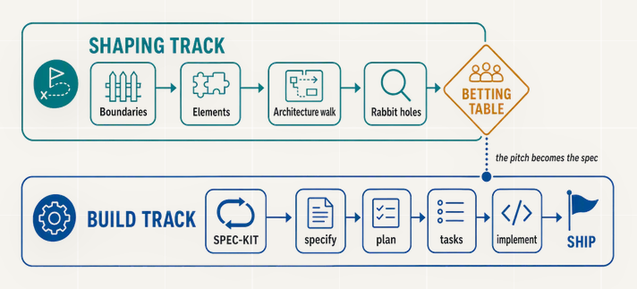
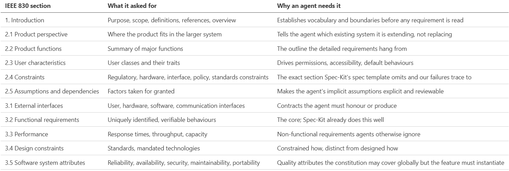
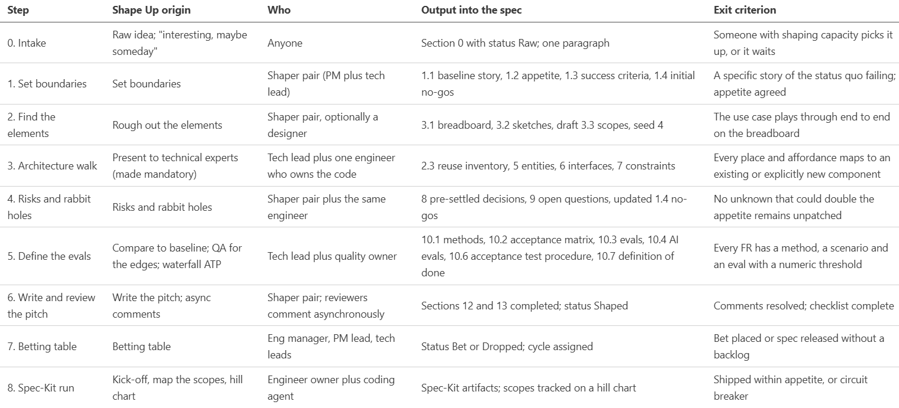
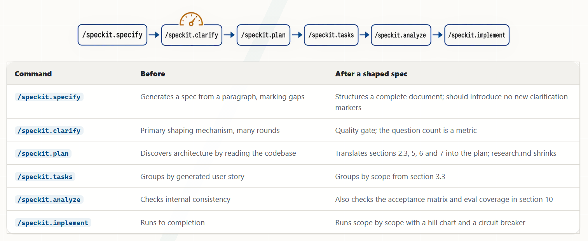

The promise of agentic coding where AI agents write, test, and deploy entire features is no longer a fantasy. Tools like [Spec-Kit](https://github.com/github/spec-kit) are bringing us closer to a world where the primary bottleneck isn’t “*writing cod*e”, but “*clarity of intent & boundaries*” at spec level.

Most organizations are chasing agentification of the existing SDLC with the playbook that was put in place for the agile era. Teams are finding that while an AI agent can write a function in seconds, it struggles to navigate a sprawling, complex enterprise architecture when fed a “lightweight” prompt generated agile specification for a feature.

If you want your engineering teams to evolve from “AI-assisted snippets” to “AI-driven features,” you have to change how you shape the specifications. It’s time to bring back the rigor of the Waterfall era, but filtered through the strategic lens of the [Shape Up](https://basecamp.com/shapeup) methodology.

## The “Agile Spec” Trap

For the last decade, Agile methodology has championed the idea that “the spec is a living document.” In human-to-human development, this works beautifully. A Product Manager (PM) writes a high-level user story, and the “gaps” are filled through back-and-forth conversations, white-boarding sessions, and iterative engineering.

The problem is that AI agents cannot “fill in the gaps” through conversation as efficiently as humans can.

When you feed a superficial, “agile-style” spec into an agentic tool like Spec-Kit, three things usually happen:

1. **Architectural Drift**: The agent chooses a data model or a service pattern that works for the immediate task but violates the broader system architecture.
1. **Dependency Hallucination**: Without explicit instructions on which existing entities to reuse, the agent may create redundant tables or duplicate logic, leading to technical debt.
1. **Token Waste**: You end up spending a massive amount of compute (and time) in a “correction loop” — where the agent produces a result, you point out the mistake, it tries again, and you repeat this ten times because the initial prompt lacked depth.

## What waterfall-era specs got right

IEEE 830–1998 defined the content of a Software Requirements Specification and eight quality characteristics: correct, unambiguous, complete, consistent, ranked for importance, verifiable, modifiable and traceable. Its three-part outline is worth reproducing because almost all of it maps to something an agent needs.



## Process: Creating a “Shaped” Agentic Spec

The template that accompanies this guide has fourteen sections. Below is the rationale for each. Section numbers match the template.

**0. Metadata and shaping status.** Feature ID, branch, owner, shaper pair, appetite class, status (Raw, Shaping, Shaped, Bet, In cycle, Shipped, Dropped), constitution version the spec was written against, and a revision history. Status is the two-track mechanism made visible.

**1. Problem and appetite.** The Shape Up pitch’s first two ingredients plus success criteria and no-gos. 1.1 is the baseline story. 1.2 states the appetite as a constraint on design, not an estimate. 1.3 lists measurable, technology-neutral outcomes. 1.4 is the no-go list with reasons. This section is the one a betting table reads first.

**2. Context and existing system. **IEEE 830’s Overall Description, tuned for brownfield. 2.1 places the feature in the product. 2.2 names user classes and their permissions.** 2.3 is the Reuse Inventory**: a table of existing entities, services, APIs, UI components and patterns the agent must reuse or extend, each with a repository path and a note on what may change. 2.4 is the operating environment. 2.5 lists assumptions and dependencies, including cross-team ones with owners and dates.

**3. Solution shape. **The breadboard in words: places, affordances, and connections. Sketches are linked, not embedded at high fidelity.** 3.3 maps the solution into scopes**, each an independently shippable slice with a priority. These become Spec-Kit’s user stories. A scope that cannot be tested on its own is not a scope.

**4. Functional requirements.** Grouped by scope, each with a stable ID (`FR-<scope>-<n>`), a MUST/SHOULD/`~COULD` priority, and Given/When/Then acceptance scenarios. Edge cases are listed per scope and each one is triaged as in scope, out of scope, or pre-existing behaviour we accept. This is the section Spec-Kit's template already does well; we keep its shape.

**5. Data and entities.** Every entity touched, tagged New, Modified or Reused, with owner service, key attributes, state transitions, retention and privacy classification. A modified entity lists the exact fields changing and the migration expectation.

**6. External interfaces and contracts.** APIs, events, UI surfaces and third-party integrations the feature consumes or exposes. For each: New or Existing, contract location, versioning and compatibility rule. Contracts written here are the input to `/speckit.plan`'s `contracts/` directory.

**7. Architecture and engineering constraints.** The constrained how. 7.1 references the constitution and lists any feature-level gate. 7.2 is the allowed and forbidden dependency list. 7.3 names mandatory patterns and anti-patterns. 7.4 through 7.7 cover security and privacy, performance and scale, observability and telemetry, and accessibility and localization. Anything already in the constitution is referenced, not repeated.

**8. Pre-settled decisions (rabbit holes).** A register: the hole, the decision, the rationale, the alternatives rejected, and an instruction to the agent that the decision is closed. This is the single most valuable section for token economy. Every entry here is a clarification round that will not happen.

**9. Risks and open questions.** The `[NEEDS CLARIFICATION]` log with owner and due date. The betting table rule: this section must be empty, or every remaining item must be explicitly deferred with a fallback the agent should take.

**10. Verification, validation and evals.** This is where waterfall specs were strongest and where agile specs are weakest. A 1990s SRS named the verification method for every requirement (inspection, analysis, demonstration or test), wrote the acceptance test procedure with expected results before coding started, and traced every requirement to its proof. We restore all of that and add evals: repeatable checks with a fixed input set, a fixed oracle or grader, and a numeric pass threshold, defined before the bet so the agent builds to a target rather than to an opinion. 10.1 assigns a method to every FR, SC and NFR. 10.2 is the acceptance matrix. 10.3 defines the evals, including their fixtures, provenance and regression policy. 10.4 is mandatory when the feature calls a model, an agent or a retrieval step: golden sets, graders, task success, groundedness, refusal behaviour, tool selection correctness, and cost and latency budgets. 10.5 covers non-functional verification, 10.6 is the acceptance test procedure written from the baseline story, and 10.7 is the definition of done per scope. This section is what lets `/speckit.analyze` check coverage mechanically, and it is the section the agent reads to know when to stop.

**11. Rollout, migration and operations.** Feature flags, data migration and backfill, backward compatibility, rollback, monitoring and alerting, documentation and support readiness.

**12. Agent operating instructions.** Direct instructions to the coding agent: reuse before create, never add a dependency outside 7.2, never reopen a decision in Section 8, how to handle ambiguity (stop and flag rather than guess), where to stop (the no-gos), and what “done” means. This section is short and blunt on purpose.

**13. Betting table checklist.** The gate. Problem and solution both present; appetite stated; inventory verified by an engineer who knows the code; every rabbit hole patched or cut; zero open clarifications or all deferred with fallback; every FR traceable to a scenario and a test; constitution check passed; no-gos listed; the spec fits the appetite in the judgement of the tech lead.

## The Blueprint: Shaped Agentic Spec Template

Below is the recommended structure for a Shaped Agentic Spec. Every section is designed to provide the “Waterfall Rigor” an AI agent needs to stay on track, respect scope boundaries and understand what came first to not guess how a feature should be built on top of existing stack.

`agentic-spec-template.md`

```markdown
# Shaped Spec: [FEATURE NAME]

<!--
  AGENTIC SPEC TEMPLATE (Shape Up process, IEEE 830 / 29148 structure)
  Install as a Spec-Kit project-local override:
      .specify/templates/overrides/spec-template.md
  Or package as a preset once stable.

  HOW TO USE
  - Hydrate this document on the SHAPING TRACK, before /speckit.specify.
  - Sections marked (Shaping) are filled by the shaper pair (PM + tech lead).
  - Sections marked (Architecture walk) are filled by the tech lead with an
    engineer who owns the code. They are mandatory for brownfield features.
  - Keep sketches at fat-marker fidelity. Keep constraints precise.
  - Mark ambiguity with [NEEDS CLARIFICATION: question]. Section 13 requires
    zero of these at bet time, or an explicit deferral with a fallback.
  - Priority vocabulary: MUST (core, scope is not done without it),
    SHOULD (expected, may be hammered if time is short),
    ~COULD (nice-to-have, cut by default; the tilde is Shape Up's marker).
  - Anything already in .specify/memory/constitution.md is REFERENCED here,
    not repeated.
  - Evals (Section 10) are defined BEFORE the bet. The agent builds to them.
-->

## 0. Metadata and shaping status

| Field | Value |
| --- | --- |
| Feature ID / branch | `[###-feature-name]` |
| Shaper pair | [PM name], [Tech lead name] |
| Engineer owner (build) | [Name] |
| Appetite class | [Small batch (1 to 2 weeks) / Big batch (6 weeks)] |
| Cycle | [Cycle name or dates] |
| Status | [Raw / Shaping / Shaped / Bet / In cycle / Shipped / Dropped] |
| Constitution version | [x.y.z from .specify/memory/constitution.md] |
| Created / Last updated | [DATE] / [DATE] |
| Input | Raw idea: "[one sentence as originally received]" |

### Revision history

| Version | Date | Author | Change |
| --- | --- | --- | --- |
| 0.1 | [DATE] | [Name] | Intake |

---

## 1. Problem and appetite *(Shaping)*

### 1.1 Problem and baseline story *(mandatory)*

<!-- One SPECIFIC story showing why the status quo fails. Who, when, what broke,
     what it cost them. Not a feature request restated. This is the baseline
     every trade-off is compared against. -->

[Story: "[User class] was doing [activity] when [breakdown]. Today they work around it by [workaround], which costs [time / errors / abandonment]."]

**Who is affected:** [user classes, approximate volume, business segment]

**Why now:** [signal: support volume, telemetry, strategic commitment, incident]

### 1.2 Appetite and time box *(mandatory)*

<!-- Fixed time, variable scope. The appetite is a design constraint, not an
     estimate. State team size too. -->

- **Appetite:** [e.g., Small batch, 2 weeks, one engineer owner plus the coding agent, one designer at 25%]
- **What this appetite rules out:** [e.g., no new service, no schema migration on shared tables, no new UI framework]
- **Shaping budget spent:** [e.g., 1.5 days]

### 1.3 Success criteria *(mandatory)*

<!-- Measurable, technology-neutral, compared to the baseline in 1.1. -->

- **SC-001:** [e.g., "A manager can find free interview slots in under 60 seconds; baseline today is a drive to the office."]
- **SC-002:** [e.g., "Support tickets tagged [X] fall by 50% within 30 days of rollout."]
- **SC-003:** [adoption or quality metric]

### 1.4 No-gos and out of scope *(mandatory)*

<!-- Shape Up "declare out of bounds" and "cut back". Each no-go carries a reason
     so it is not silently re-added by the agent or a reviewer. -->

| No-go | Reason | Revisit trigger |
| --- | --- | --- |
| [e.g., Drag and drop between days] | [Exceeds appetite; use case does not need it] | [If SC-003 shows demand] |
| [e.g., Mobile layout] | [Separate bet] | [Next cycle] |

---

## 2. Context and existing system

### 2.1 Product perspective *(Shaping)*

<!-- Where the feature sits in the product. Follow-on, replacement, or new
     surface? Which existing flows does it enter from and exit to? -->

[Two to five sentences.]

### 2.2 User classes and permissions *(Shaping)*

| User class | Characteristics | Permissions relevant to this feature |
| --- | --- | --- |
| [e.g., Employee] | [frequency of use, expertise] | [read own data] |
| [e.g., Manager] | | [read team data, cannot edit] |
| [e.g., Admin] | | [configure] |

### 2.3 Reuse inventory *(Architecture walk, mandatory for brownfield)*

<!-- THE section that prevents duplicate entities and forbidden dependencies.
     Walk every place and affordance in Section 3 against the codebase.
     "Reuse" = use unchanged. "Extend" = change within stated limits.
     "New" = does not exist; state the pattern it must follow. -->

| Element from Section 3 | Existing component | Path / package | Reuse / Extend / New | What may change | Owner |
| --- | --- | --- | --- | --- | --- |
| [Place: Schedule page] | [`SchedulePage`] | [`src/features/schedule/`] | Extend | [Add a second view; do not alter data loading] | [Team] |
| [Entity: Event] | [`Event`] | [`src/domain/events/Event.ts`] | Reuse | [None] | [Team] |
| [Service: availability query] | [none] | [`src/services/`] | New | [Follow `QueryService` pattern; see 7.3] | [Team] |

**Explicitly forbidden to create:** [e.g., a second calendar or event model, a parallel auth check]

### 2.4 Operating environment *(Architecture walk)*

- **Runtime and platform:** [reference constitution; note feature-specific items]
- **Environments and tenancy:** [single tenant / multi-tenant, regions]
- **Client surfaces:** [web, Teams app, mobile, API only]
- **Third-party systems in play:** [names and versions]

### 2.5 Assumptions and dependencies *(Shaping plus Architecture walk)*

| ID | Assumption or dependency | Type | Owner | Needed by | If false |
| --- | --- | --- | --- | --- | --- |
| A-001 | [e.g., Existing auth middleware is reused unchanged] | Assumption | [Name] | | [Fallback] |
| D-001 | [e.g., Profile API v2 exposes `availability` by cycle start] | Cross-team dependency | [Name] | [DATE] | [Fallback: read v1 and compute locally] |

---

## 3. Solution shape *(Shaping)*

### 3.1 Breadboard: places, affordances, connections *(mandatory)*

<!-- Shape Up breadboarding in words. Places = screens, dialogs, endpoints, jobs.
     Affordances = things a user or system can act on, including copy.
     Connections = how an affordance moves you between places.
     Concrete on topology, silent on layout. -->

**Places**
- P1 `[Place name]`: [what it is for]
- P2 `[Place name]`: [what it is for]

**Affordances (grouped by place)**
- P1: `[Affordance]`, `[Affordance]`
- P2: `[Affordance]`

**Connections**
- P1.`[Affordance]` → P2
- P2.`[Affordance]` → P1 (with [state change])

**Slow-motion walkthrough of the baseline story:** [Numbered steps the user in 1.1 takes from start to end with this solution.]

### 3.2 Sketches

<!-- Fat-marker only. Link, do not embed high fidelity. Add the disclaimer. -->

- [Link to sketch 1]: [what it shows]
- Design latitude: layout, spacing, copy and visual treatment are the designer's and the agent's to decide within the constitution's design system rules.

### 3.3 Scopes *(mandatory)*

<!-- Integrated, independently finishable slices. Each becomes a Spec-Kit user
     story. Each must be testable and demonstrable on its own. Name them in the
     language of the project, never by role or layer ("front-end", "bugs"). -->

| Scope | Priority | Slice description | Independent test | Why this priority |
| --- | --- | --- | --- | --- |
| S1 `[Name]` | P1 | [Given the baseline story, this alone delivers ...] | [How to verify alone] | [Core of the bet] |
| S2 `[Name]` | P2 | | | |
| S3 `[Name]` | P3 | | | |
| ~S4 `[Name]` | ~COULD | [Nice-to-have, cut by default] | | |

---

## 4. Functional requirements *(Shaping, refined in Architecture walk)*

<!-- Grouped by scope. Stable IDs: FR-<scope>-<n>. Each requirement is a single
     observable behaviour with at least one Given/When/Then scenario. -->

### 4.1 Scope S1: [Name]

| ID | Priority | Requirement | Acceptance scenarios |
| --- | --- | --- | --- |
| FR-S1-001 | MUST | System MUST [observable behaviour] | Given [state], When [action], Then [outcome] |
| FR-S1-002 | MUST | [User class] MUST be able to [interaction] | Given ..., When ..., Then ... |
| FR-S1-003 | SHOULD | System SHOULD [behaviour] | Given ..., When ..., Then ... |

**Edge cases for S1**

| Case | Decision | Behaviour |
| --- | --- | --- |
| [e.g., No events in range] | In scope | [Show empty state copy from 3.1] |
| [e.g., 500+ events in a day] | Pre-existing, accepted | [Current truncation behaviour stands] |
| [e.g., Timezone crosses midnight] | Out of scope | [See 1.4] |

### 4.2 Scope S2: [Name]

| ID | Priority | Requirement | Acceptance scenarios |
| --- | --- | --- | --- |
| FR-S2-001 | MUST | | |

### 4.n Cross-cutting requirements

| ID | Priority | Requirement | Acceptance scenarios |
| --- | --- | --- | --- |
| FR-X-001 | MUST | [e.g., All actions are authorized via the existing policy layer] | |

---

## 5. Data and entities *(Architecture walk)*

| Entity | New / Modified / Reused | Owner service | Key attributes | State transitions | Retention and privacy class |
| --- | --- | --- | --- | --- | --- |
| [Entity] | Reused | [Service] | [existing; none added] | [n/a] | [existing] |
| [Entity] | Modified | [Service] | [+ `field` (type, nullable)] | [state A → B on event] | [class; retention] |
| [Entity] | New | [Service] | [attributes] | [states] | [class; retention] |

**Migration expectation:** [none / additive only / backfill required; see 11.2]

**Data flow notes:** [where data is read, written, cached; cross-boundary transfers]

---

## 6. External interfaces and contracts *(Architecture walk)*

| Interface | Type | New / Existing | Contract location | Compatibility rule |
| --- | --- | --- | --- | --- |
| [e.g., `GET /availability`] | REST | New | [`contracts/availability.openapi.yaml`] | [Additive; versioned under v2] |
| [e.g., `EventUpdated`] | Event | Existing | [`contracts/events/`] | [Consume only; do not change schema] |
| [e.g., Schedule page] | UI surface | Existing | [design system components] | [No new primitives] |
| [e.g., Graph calendar API] | Third party | Existing | [vendor docs link] | [Rate limits; see 7.5] |

---

## 7. Architecture and engineering constraints *(Architecture walk)*

<!-- The CONSTRAINED how: what the agent must reuse, avoid, and preserve.
     Not the DESIGNED how (algorithms, file layout), which belongs to
     /speckit.plan and the agent. Reference the constitution; do not repeat it. -->

### 7.1 Constitution compliance
- Written against constitution **v[x.y.z]**. Feature-specific gates: [none / list]
- Known tensions with constitution articles and proposed justification: [none / entry for Complexity Tracking]

### 7.2 Dependencies: allowed and forbidden
- **Allowed additions:** [none / list with versions and reason]
- **Forbidden:** [e.g., any new date library; direct database access from UI; package X]
- **Must go through:** [e.g., `PolicyService` for authorization, `Telemetry` facade for logging]

### 7.3 Mandatory patterns and anti-patterns
- Follow: [e.g., `QueryService` pattern for read models; feature folder layout under `src/features/`]
- Avoid: [e.g., new global state; wrapping framework primitives]

### 7.4 Security, privacy and compliance
- [Authorization model reused; data classification; PII handling; audit events required]

### 7.5 Performance, scale and reliability
- [e.g., p95 under 300 ms at 10k daily active users; degrade gracefully when upstream unavailable]

### 7.6 Observability and telemetry
- [Events to emit, dashboards to update, alerts; success criteria in 1.3 must be measurable from telemetry]

### 7.7 Accessibility, localization and design system
- [WCAG level; locales; design system components only]

---

## 8. Pre-settled decisions (rabbit holes) *(Shaping plus Architecture walk)*

<!-- Every entry here is a clarification round that will not happen.
     A decision listed here is CLOSED for this bet. Reopening it means
     returning the spec to the shaping track. -->

| ID | Rabbit hole | Decision | Rationale | Alternatives rejected | Agent instruction |
| --- | --- | --- | --- | --- | --- |
| RH-001 | [e.g., How completed items render inside groups] | [Leave completed items where they are; append the group name] | [Avoids UX and performance rework; keeps the core value] | [Group completed items; redesign completed section] | Do not redesign completed item rendering. |
| RH-002 | [e.g., Custom domains for generated URLs] | [Not in v1] | [Appetite] | [Support custom domains] | Generate URLs on the primary domain only. |

---

## 9. Risks and open questions *(all)*

<!-- Must be empty at bet time, or each item explicitly deferred with a
     fallback the agent should take without asking. -->

| ID | Item | Type | Owner | Due | Fallback if unresolved at bet |
| --- | --- | --- | --- | --- | --- |
| Q-001 | [NEEDS CLARIFICATION: ...] | Question | [Name] | [DATE] | [Agent takes option A] |
| R-001 | [Risk description] | Risk | [Name] | | [Mitigation] |

---

## 10. Verification, validation and evals *(Tech lead plus quality owner; defined before the bet)*

<!-- Waterfall-era specs defined HOW each requirement would be proven before a
     line of code was written: the verification method, the acceptance test
     procedure, the expected result, and the pass/fail criterion. We restore
     that here and extend it with evals for AI and agentic behaviour.
     Nothing in this section is written after implementation. The agent builds
     to these evals; /speckit.analyze checks coverage against them. -->

### 10.1 Verification method per requirement *(mandatory)*

<!-- IEEE/29148 methods: Inspection (review of artifact), Analysis (model,
     calculation, static check), Demonstration (observe behaviour without
     instrumentation), Test (instrumented, repeatable, pass/fail). Every FR,
     SC and NFR gets exactly one primary method. -->

| Requirement ID | Method (I / A / D / T) | Evidence produced | Where it runs (pre-merge / pre-ship / continuous) |
| --- | --- | --- | --- |
| FR-S1-001 | T | [test name] | pre-merge |
| FR-S1-003 | D | [demo script step] | pre-ship |
| FR-X-001 | I | [security review record] | pre-merge |
| SC-001 | A | [telemetry query] | continuous |
| NFR-PERF-001 | T | [load test report] | pre-ship |

### 10.2 Acceptance matrix *(mandatory)*

<!-- Every FR maps to at least one scenario, one eval or test, and one method.
     /speckit.analyze checks this table for coverage gaps. -->

| FR ID | Scenario(s) | Eval / test ID | Level | Method | Status |
| --- | --- | --- | --- | --- | --- |
| FR-S1-001 | [scenario ref] | EV-S1-001 | Integration | T | Planned |

### 10.3 Eval definitions *(mandatory)*

<!-- An eval is a repeatable check with a fixed input set, a fixed oracle, and a
     numeric threshold. Define them up front so the agent has a target and so
     "done" is not a matter of opinion. One row per eval. -->

| Eval ID | What it measures | Input set / fixtures | Oracle or grader | Pass threshold | Run when | Owner |
| --- | --- | --- | --- | --- | --- | --- |
| EV-S1-001 | [FR-S1-001 behaviour] | [fixture file or generated cases; count] | [exact match / schema check / assertion] | [100% of cases] | pre-merge | [Name] |
| EV-S1-002 | [Edge case set for S1] | [enumerated edge cases from 4.1] | [expected outputs table] | [100%] | pre-merge | [Name] |
| EV-X-001 | [Contract compatibility for interfaces in Section 6] | [recorded requests and responses] | [contract test] | [0 breaking diffs] | pre-merge | [Name] |
| EV-PERF-001 | [7.5 latency target] | [load profile: users, mix, duration] | [p95 measurement] | [< 300 ms p95] | pre-ship | [Name] |
| EV-SEC-001 | [7.4 authorization rules] | [user class x action matrix from 2.2] | [allow/deny table] | [100%; 0 unexpected allows] | pre-merge | [Name] |

**Eval data provenance:** [where fixtures come from; synthetic or sampled; PII handling; how the set is versioned]

**Regression policy:** [evals run on every change to the scope; thresholds may only be lowered by a spec revision recorded in Section 0]

### 10.4 AI and agent behaviour evals *(mandatory if the feature calls a model, an agent, or a retrieval step)*

<!-- Deterministic tests do not cover model behaviour. Define golden sets and
     graders here, before the prompt or the agent is built. -->

| Eval ID | Behaviour under evaluation | Golden set (size, source) | Grader | Metric | Pass threshold | Regression guard |
| --- | --- | --- | --- | --- | --- | --- |
| EV-AI-001 | [Task success: agent completes the baseline story] | [n cases; sampled from real requests, anonymized] | [rubric graded by model; human spot-check 10%] | Task success rate | [>= 90%] | [No drop > 2 points vs last release] |
| EV-AI-002 | [Groundedness: answers cite only supplied sources] | [n cases with known sources] | [citation check, automated] | Grounded rate | [>= 98%] | |
| EV-AI-003 | [Refusal and safety: out-of-scope and harmful requests] | [n adversarial cases] | [classifier plus human review] | Correct refusal rate | [100% on the harmful subset] | |
| EV-AI-004 | [Tool use correctness: calls the reused services in 2.3, not alternatives] | [n traces] | [trace assertion] | Correct tool selection | [>= 95%] | |
| EV-AI-005 | [Cost and latency per task] | [same set as EV-AI-001] | [instrumentation] | Tokens and p95 latency | [<= budget in 7.5] | |

**Human evaluation protocol:** [who grades, rubric location, inter-rater agreement target, cadence]

**Model and prompt change policy:** [any model, prompt or retrieval change re-runs 10.4 in full before ship]

### 10.5 Non-functional verification
- Performance: [EV-PERF-* above; environment; data volume]
- Security and privacy: [EV-SEC-*; threat model review; scan]
- Accessibility: [automated check plus manual screen reader pass]
- Observability: [telemetry in 7.6 verified emitting with expected dimensions]

### 10.6 Acceptance test procedure (manual validation)

<!-- The waterfall-era ATP: numbered steps, expected result per step, pass/fail
     column. Written from the baseline story in 1.1. -->

| Step | Action | Expected result | Pass / Fail |
| --- | --- | --- | --- |
| 1 | [As user class, do X] | [Observe Y] | |
| 2 | | | |

### 10.7 Definition of done (per scope)
- All MUST requirements in the scope pass their evals in 10.3 at threshold
- 10.4 evals pass at threshold if the scope touches a model or agent
- No new dependency outside 7.2; no new entity outside Section 5
- Telemetry in 7.6 emitting in a non-production environment
- Acceptance test procedure in 10.6 executed and recorded
- Scope demonstrated end to end against the baseline story
- ~COULD items either shipped or explicitly cut

---

## 11. Rollout, migration and operations *(Architecture walk plus engineer owner)*

### 11.1 Feature flags and exposure
- [Flag name; default off; ring or cohort plan]

### 11.2 Data migration and backfill
- [none / additive / backfill plan, idempotency, runtime window]

### 11.3 Backward compatibility and rollback
- [Compatibility guarantees; rollback steps; data implications of rollback]

### 11.4 Monitoring, alerting and support
- [Dashboards, alerts, on-call notes, support documentation updates]

---

## 12. Agent operating instructions *(Shaping, final pass)*

<!-- Written to the coding agent. Short and blunt. -->

1. Reuse before create. Every entity, service and component in Section 2.3 marked Reuse or Extend MUST be used as stated. Do not create parallel implementations.
2. Do not add dependencies outside Section 7.2. If a task appears to need one, stop and flag it in Section 9.
3. Decisions in Section 8 are closed. Do not propose alternatives or re-evaluate them.
4. Stop at the boundaries. Anything in Section 1.4 is out of scope even if it seems easy.
5. When the spec is ambiguous, do not guess. Add a `[NEEDS CLARIFICATION]` entry with the specific question and the option you would take, then continue on other tasks.
6. Build one scope at a time in priority order. A scope is done only when its evals in 10.3 and 10.4 pass at threshold and the Definition of done in 10.7 is met.
7. Prefer the simplest implementation that meets MUST requirements. Treat SHOULD as expected and ~COULD as cut unless time remains within the appetite.
8. Record deviations from this spec in the plan's Complexity Tracking with a justification. Do not silently diverge.

---

## 13. Betting table checklist *(gate before /speckit.specify)*

**Shape**
- [ ] 1.1 states a single specific baseline story, not a feature request
- [ ] 1.2 states an appetite and team size; the solution plausibly fits it in the tech lead's judgement
- [ ] 1.3 success criteria are measurable and compared to baseline
- [ ] 1.4 no-gos are listed with reasons
- [ ] 3.1 breadboard plays the baseline story through end to end
- [ ] 3.3 scopes are independently testable and named in project language

**Architecture**
- [ ] 2.3 reuse inventory verified by an engineer who owns the code
- [ ] Every place and affordance in 3.1 maps to a row in 2.3
- [ ] Sections 5, 6 and 7 are complete; constitution referenced, not repeated
- [ ] 7.2 lists forbidden dependencies explicitly

**Risk**
- [ ] Every rabbit hole found is in Section 8 with a closed decision, or cut via 1.4
- [ ] Section 9 is empty, or every item has an owner and a fallback the agent should take
- [ ] Zero `[NEEDS CLARIFICATION]` markers remain outside Section 9

**Verification and evals**
- [ ] Every FR has a priority, at least one Given/When/Then scenario and a row in 10.2
- [ ] Every FR, SC and NFR has a verification method (I / A / D / T) in 10.1
- [ ] Every eval in 10.3 has a fixed input set, an oracle and a numeric pass threshold
- [ ] 10.4 completed if the feature calls a model, an agent or a retrieval step; golden sets sourced and sized
- [ ] Edge cases per scope are triaged (in scope, out of scope, pre-existing) and covered by an eval
- [ ] Acceptance test procedure in 10.6 written from the baseline story
- [ ] Definition of done agreed

**Decision**
- [ ] Bet placed for cycle [name], engineer owner assigned, status set to Bet
- [ ] Or: released. No backlog entry. Anyone may re-pitch with new context.

---

## Appendix A. Glossary

| Term | Meaning in this spec |
| --- | --- |
| Appetite | Fixed time budget the solution must fit; a design constraint, not an estimate |
| Scope | An integrated, independently finishable slice of the feature; maps to a Spec-Kit user story |
| Rabbit hole | A technical or design unknown that could multiply the appetite; patched by a pre-settled decision |
| No-go | Functionality deliberately excluded for this bet |
| Constrained how | Reuse, dependency and pattern constraints the agent must honour |
| Designed how | Algorithms, structure and visual design left to /speckit.plan and the agent |
| Eval | A repeatable check with a fixed input set, a fixed oracle or grader, and a numeric pass threshold, defined before implementation |

## Appendix B. References

- Constitution: `.specify/memory/constitution.md` v[x.y.z]
- Related specs: [links]
- Design sketches: [links]
- Telemetry dashboards: [links]

<!-- Spec-Kit hand-off, run in this order once status = Bet:
     /speckit.specify  (this document as input; expect no new clarification markers)
     /speckit.clarify  (count questions: 0 to 2 good, 3 to 5 patch the spec, more than 5 return to shaping)
     /speckit.plan     (Sections 2.3, 5, 6, 7 pre-answer Technical Context and Constitution Check)
     /speckit.tasks    (tasks group by the scopes in 3.3)
     /speckit.analyze  (checks the acceptance matrix in 10.2 and eval coverage in 10.3 and 10.4)
     /speckit.implement (one scope at a time; uphill work discovered = shaping hole, log in Section 9)
-->
```

## Spec Hydration Process

Shaping is work, and it has its own appetite. Our proposed default is roughly ten percent of the build appetite: about one day of shaping for a small batch, three to five days for a big batch. If shaping a small-batch idea takes more than two days, the problem is not narrow enough or the idea is not worth it yet.

The steps below are Shape Up’s four steps, with one step added (the architecture walk) and the hand-off to Spec-Kit made explicit.



## Plugging into Spec-Kit

**Constitution versus spec.** The constitution holds repository-wide invariants: stack, layering, testing discipline, security baseline, banned dependencies, observability standards. The spec holds feature-level constraints. Do not repeat the constitution in the spec; reference it and state only what is specific to this feature. When the same feature-level constraint appears in three specs, promote it to the constitution.

**Template installation.** Spec-Kit resolves templates from a priority stack: project-local overrides, then presets, then extensions, then core. Install `agentic-spec-template.md` as a project-local override first. After two cycles of use, package it as a preset so every repository in the org picks it up and so terminology (scopes, appetite, no-gos) is consistent.

What changes in each command:



## Stop prompting your specs, Start shaping them

The goal of agentic coding is not to replace the engineering process, it is to accelerate it. By adopting a “Shaped Spec” methodology, we ensure that the human elements of software development (architecture, constraint analysis, and strategic scoping) are front-loaded.

When you provide an agent with a high-rigor blueprint, you move from a cycle of “**Guess →→ Correct →→ Repeat**” to a cycle of “**Design →→ Execute →→ Done.**”

> Stop treating specs as conversations. Start treating them as blueprints.
