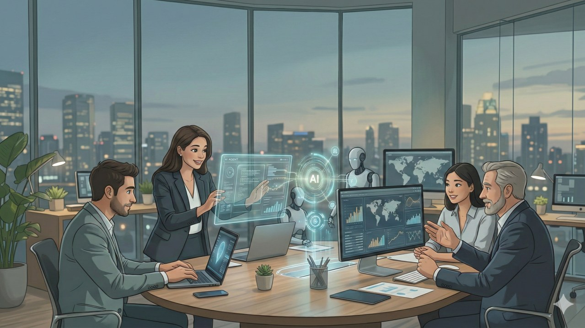
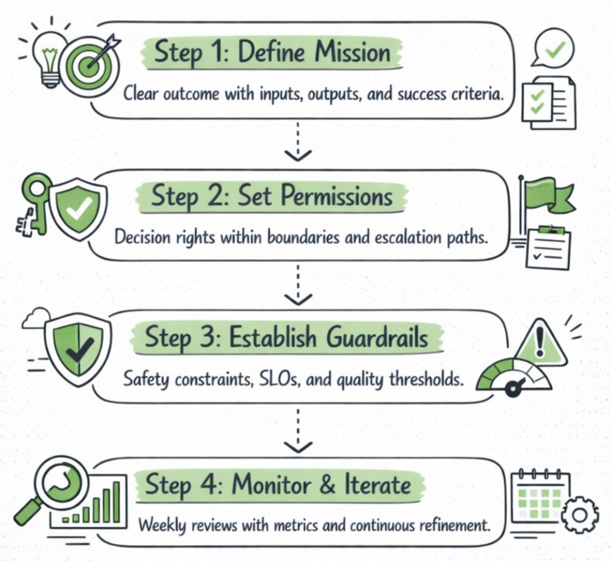
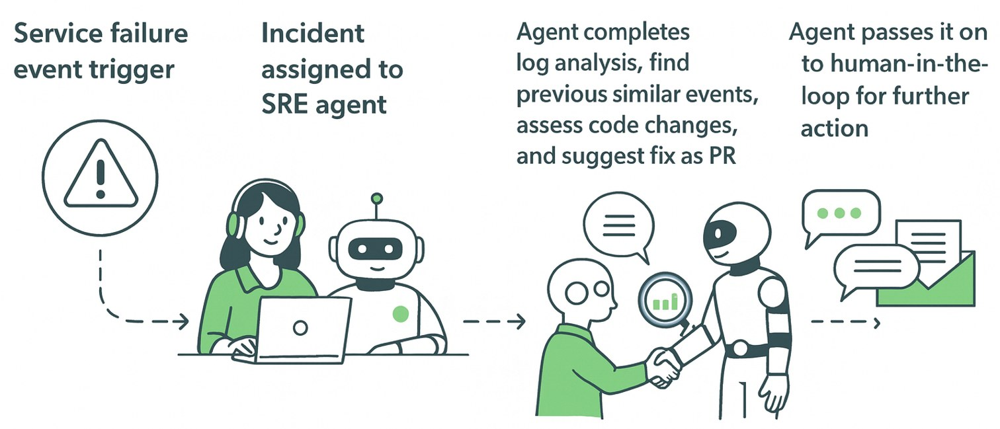
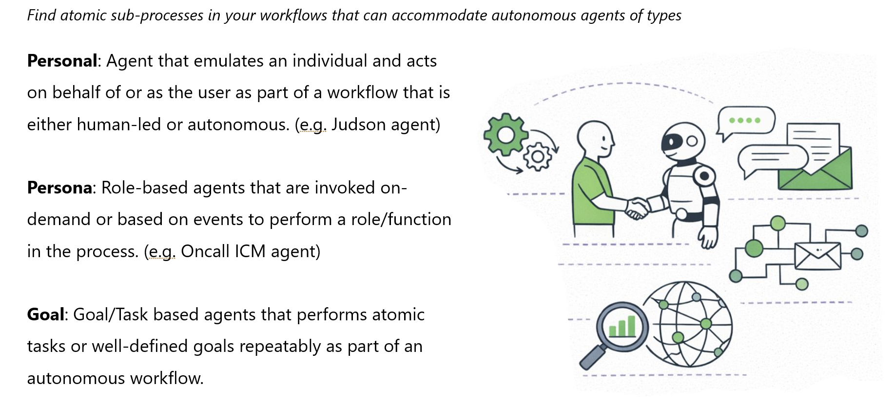

AI is no longer just something we **use**, it’s something we increasingly **work with**. And that subtle pivot changes far more than tooling. It changes workflows. It changes skills. And ultimately, it changes what it means to lead and contribute on a team.

This article is my perspective on that shift and on why the next frontier of team design is not about replacing people with AI, but about **rethinking how humans and agents work together**.

## From AI Assistance to Agent‑Driven Work

Much of today’s AI adoption lives in the tactical layer of work. We use copilots to summarize, draft, search, or assist decision‑making. These are meaningful gains, but they’re incremental.

The real step change comes when we move beyond assistance and start embracing agents:

- Agents that execute end‑to‑end operational tasks
- Agents that act with autonomy within defined guardrails
- Agents that participate in workflows continuously, not on demand

When this happens, the way we work naturally

- **Operational work** becomes increasingly autonomous
- **Tactical work** becomes agent‑assisted
- **Strategic work** remains human‑led, but deeply AI‑augmented

The opportunity isn’t to push humans out of the system. It’s to pull humans up the stack, toward work that requires judgment, vision, ethics, and creativity.

## Why Org Charts Start to Break

As agents take on meaningful slices of execution, traditional org charts begin to show their limits.

Org charts are optimized for: Functions, Reporting lines, Static roles. But agent‑driven work is dynamic. It’s **outcome‑oriented**. It cuts horizontally across teams.

This is why the idea of a “**work chart**” matters. Organizing around what needs to get done, not just who reports to whom.

In practice, this means:

- Vertical silos giving way to horizontal layers
- Skills and workflows becoming more important than titles
- Teams re‑forming around problems, not functions

This shift isn’t theoretical. It’s already happening quietly wherever agents are embedded deeply into real workflows.

## The Rise of the “Agent Boss”

This brings us to a role or more accurately, a **mindset **that will become increasingly common — the** Agent Boss**.

An Agent Boss is not necessarily a people manager (*in fact its better suited for tech leads and architects to pioneer*). It’s someone who:

- Orchestrates a portfolio of AI agents
- Designs workflows where humans and agents collaborate
- Defines clear outcomes, guardrails, and decision rights
- Owns quality, cost, and evolution of agent‑driven systems

In many ways, this is the natural evolution of a highly empowered individual contributor. Future engineers, product managers, and operators won’t just write code or documents, they’ll **design and manage agentic systems**. Most software engineering job roles in future will evolve to some variation/level of agentic systems architect.

## Treat Agents Like Team Members

One practical mental shift makes this transition easier: **treat agents the way you treat people on your team**.

This would mean, the agent boss would:

- Writing a clear “job description” for an agent
- Defining inputs, outputs, and decision rights
- Establishing guardrails, SLAs, and escalation paths
- Instrumenting telemetry : quality, cost, acceptance, drift
- Assigning a clear owner

Agents, like people, should grow in stages of maturity: From **assisted **->To** partnered **-> To increasingly** autonomous**. This framing removes a lot of the ambiguity around “how to start” with agents.

## Recruiting and Growing Agents

In a human+agent team, coordination doesn’t need a middle layer — it needs orchestration. Similar to how a team manager identifies the role needs for a team, an agent boss identifies where we have agent recruitment needs.

Agent Boss is responsible for

- Identify the need for an agent and define the type and requirements
- Recruit the agent into the team’s process/workflow
- Setup goals for the agent’s maturity roadmap with metrics for success at each stage
- Inspect, modify, and improve the agent continuously
- Get the agent to grow from human-led, assisted to fully autonomous working model

## Example Role Based Agent — SRE Agent

## Re-think your workflows to recruit more agents

Re-assessing existing workflows is the first action step for teams to identify where and what types of agents can atomically fit and fill process needs. Do not try to automate an existing whole process, instead de-construct the entire process step to see where autonomous and assisted agents are best utilized.

> *“AI requires change management. It isn’t just about using a tool **but how using a tool changes what I work on**, how I work, and the workflow.” — *Satya Nadella | CEO, Microsoft

## Scaling the Human + Agent Ratio

A projection theory calls for teams moving toward **agent‑to‑human ratios of 10:1 or even 25:1 over the next decade**. This is often misunderstood as less humans and more agents. It does *not* mean fewer people. It means more of the right work getting done by the right entities.

As agents absorb repeatable sub‑processes, humans gain space to Innovate, Improve quality, Tackle harder problems and move faster where judgment matters most.

> *“The constraint becomes orchestration, not coordination”*

If there’s a single takeaway I’d leave you with, it’s this: **Start with one agent**. One workflow. One clearly defined role. One place where value is obvious. **Learn from it -> Refine it -> Scale it**. Frontier teams aren’t built by sweeping transformation programs. They’re built by **compounding small, intentional shifts in how work gets done**.

## Closing Thought

> *“AI transformation isn’t primarily a technology problem. It’s a **mindset problem.**”*

The teams that win won’t be the ones with the most tools — it will be the ones who rethink how work, skills, and leadership evolve in a human + agent world. That is what is going to accelerate your journey towards a frontier team/firm.
